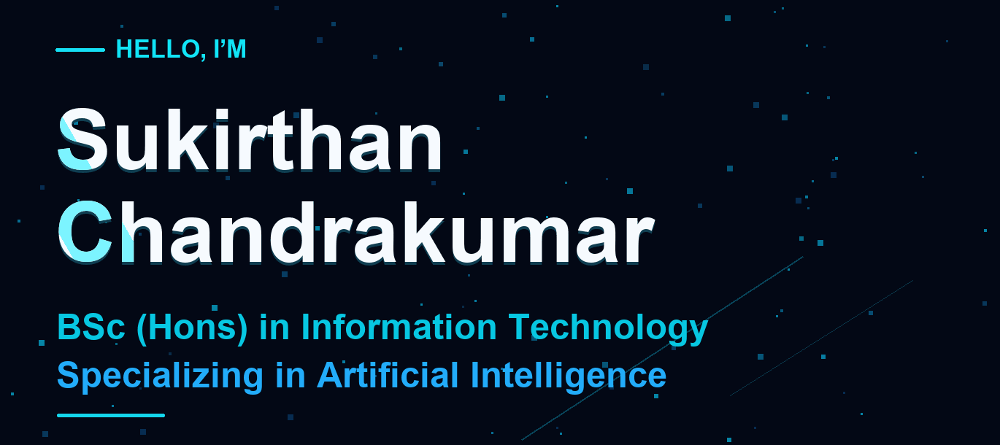

## About me

I am an IT undergraduate specializing in Artificial Intelligence, passionate about AI, Machine Learning, and full-stack development. I am currently seeking an AI/ML Engineering Internship to apply my skills, gain real-world experience, and grow as an AI/ML engineer.

I am also gaining hands-on experience as a **Full Stack Engineering Intern**:

- 📱 Working with **React Native, Expo, Flutter, and backend APIs**.
- 🛍️ Gaining hands-on experience with a **retail POS application**.
- 🤖 Exploring **agentic AI, automation, and computer vision**.
- 🌱 Currently learning more about **Flutter, Dart, and AI application development**.

### What I'm building

I enjoy turning ideas into practical projects, especially tools for safer travel, better decisions, and everyday business workflows. You can follow my work in the repositories below.

## Technologies

### 🎨 Frontend & Mobile

&nbsp;&nbsp;&nbsp;&nbsp;

React Native · Expo · Flutter

<!-- Add the other technology groups after Sukirthan provides his confirmed list. -->
